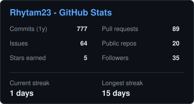

  

# 

# 💫 About Me:
👋 Hi, I’m @Rhytam23 👀 I’m interested in Coding, learning new coding languages, 🌱 I’m currently learning Python, C 💞️ I’m looking to collaborate on a Small public project 😄 Pronouns: He/Him ⚡ Fun fact: I am a better orator than a narrator. Always there to help you

## 🌐 Socials:
       

## 💻 Tech Stack:
**Languages** 
      

**Frontend** 
     

**Backend & Data** 
        

**Apps & Tooling** 
       

**Design** 
 

## 📊 GitHub Stats:

 

## ⚡ Recent Merged PRs
<!--ACTIVITY:START-->
- `2026-11-18` **Merged** - [feat(client): switch the student dashboard to the new theme…](https://github.com/vicharanashala/spurti/pull/243)
- `2026-11-18` **Merged** - [feat(client): add UI building blocks and theme (part 1 of 2…](https://github.com/vicharanashala/spurti/pull/242)
- `2026-11-18` **Merged** - [fix(server): route rejected async handlers to an error…](https://github.com/vicharanashala/spurti/pull/228)
- `2026-11-12` **Merged** - [Windows and Linux: Flow can hide the pill until you dictate](https://github.com/Louis-CFM/coucou/pull/1090)
- `2026-11-12` **Merged** - [Android 0.5.0: swipe the island away, Do Not Disturb, six…](https://github.com/Louis-CFM/coucou/pull/1089)
- `2026-11-03` **Merged** - [Android 0.4.0: the Mac can link with Coucou for Android](https://github.com/Louis-CFM/coucou/pull/1054)
<!--ACTIVITY:END-->

## 📂 Top Contributed Repos
<!--TOP-REPOS:START-->

<!--TOP-REPOS:END-->

---

  ## 💰 You can help me by Donating
    

# Jokes Before you go
  

<!-- Proudly created with GPRM ( https://gprm.itsvg.in ) -->
