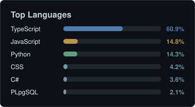

  

# 

# 💫 About Me:
👋 Hi, I’m @Rhytam23 👀 I’m interested in Coding, learning new coding languages, 🌱 I’m currently learning Python, C 💞️ I’m looking to collaborate on a Small public project 😄 Pronouns: He/Him ⚡ Fun fact: I am a better orator than a narrator. Always there to help you

## 🌐 Socials:
       

## 💻 Tech Stack:
              

## 📊 GitHub Stats:

 

## 🚀 Featured Projects
<!--FEATURED:START-->
| Project | About | Language | Stars |
|---|---|---|---:|
| [note-saver](https://github.com/Rhytam23/note-saver) | NoteNirman: a free, offline-first notes app for students. Web, Windows, Android and Telegram, with sync, tags and math. Source-available (PolyForm Noncommercial). | TypeScript | 0 |
| [kaavalu](https://github.com/Rhytam23/kaavalu) | - | Python | 0 |
| [eviq-ai](https://github.com/Rhytam23/eviq-ai) | - | TypeScript | 0 |
| [geodesis](https://github.com/Rhytam23/geodesis) | Geospatial digital twin and research agent for climate-resilient rice farming in the Mekong Delta. Nemotron on Nebius Token Factory, live evidence via Tavily. | TypeScript | 0 |
| [asia101](https://github.com/Rhytam23/asia101) | - | TypeScript | 0 |
| [pocketdeck](https://github.com/Rhytam23/pocketdeck) | Phone-first app to watch, steer and approve any AI coding agent on any machine. Early planning. | TypeScript | 0 |
<!--FEATURED:END-->

## ⚡ Recent Activity
<!--ACTIVITY:START-->
- `2026-11-14` 🔀 Closed PR [Rhytam23/coucou#33](https://github.com/Rhytam23/coucou/pull/33)
- `2026-11-14` 🔀 Opened PR [Rhytam23/coucou#33](https://github.com/Rhytam23/coucou/pull/33)
- `2026-11-13` 🔀 Opened PR [Louis-CFM/coucou#1098](https://github.com/Louis-CFM/coucou/pull/1098)
- `2026-11-12` 🔀 Opened PR [Louis-CFM/coucou#1090](https://github.com/Louis-CFM/coucou/pull/1090)
- `2026-11-12` 🔀 Opened PR [Louis-CFM/coucou#1089](https://github.com/Louis-CFM/coucou/pull/1089)
- `2026-11-09` 🔀 Closed PR [vicharanashala/vibe#1433](https://github.com/vicharanashala/vibe/pull/1433)
<!--ACTIVITY:END-->

## 🔝 Top Contributed Repo
<!--TOP-REPOS:START-->
| Repo | Commits | Language | ⭐ |
|---|---:|---|---:|
| [Rhytam23/note-saver](https://github.com/Rhytam23/note-saver) | 199 | TypeScript | 0 |
| [Rhytam23/social](https://github.com/Rhytam23/social) | 133 | TypeScript | 1 |
| [Rhytam23/nitisetu](https://github.com/Rhytam23/nitisetu) | 45 | JavaScript | 0 |
| [Rhytam23/ccn](https://github.com/Rhytam23/ccn) | 45 | Python | 0 |
| [Louis-CFM/coucou](https://github.com/Louis-CFM/coucou) | 40 | Swift | 7326 |
<!--TOP-REPOS:END-->

---

  ## 💰 You can help me by Donating
    

# Jokes Before you go
  

<!-- Proudly created with GPRM ( https://gprm.itsvg.in ) -->
